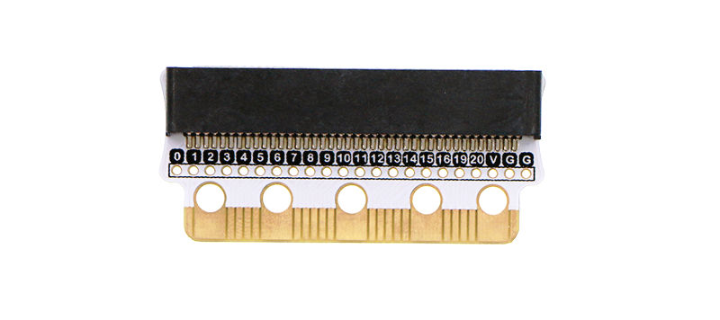
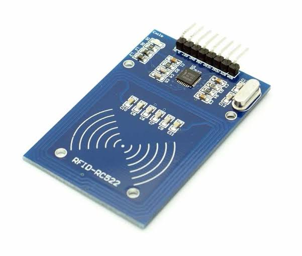

# RFID & EdgeBit hardware

This is a **hardware setup guide** for workshop coordinators. It is not a student lab.

## Workshop end goal

Mount an RFID-RC522 scanner on the micro:bit car (via EdgeBit) so the car can read **track tags** during a tag-based race. Different tags can later trigger effects such as **spin-out** or **slow**.

## Hardware at a glance

## What this guide covers

- What EdgeBit is and how it connects
- What the RC522 module is
- Wiring / pin map
- Firmware notes and known pin gotchas
- High-level mounting tips on the car

Supplementary (only if needed): [Editing the RFID library (`custom.ts`)](../book-b/index.html) — including the **P13 → P9** SCK fix and regenerating the MakeCode share link.

## What this guide does not cover

- Student exercises
- Coding tag effects (spin-out / slow) in MakeCode
- Full race game design

A working reference MakeCode project (facilitators only):  
[https://makecode.microbit.org/_YbTgFfazUVa6](https://makecode.microbit.org/_YbTgFfazUVa6)
