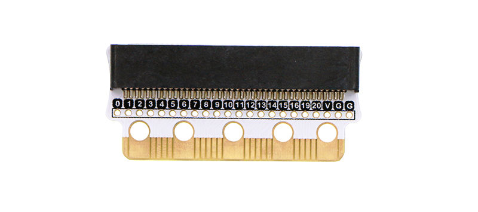

# EdgeBit

## What it is

EdgeBit is a breakout / connector board that attaches to the **micro:bit edge connector**. It exposes pins and mounting options so you can wire accessories (like the RC522) without soldering directly to the micro:bit.

## Why use it on the car

- Gives stable access to GPIO / SPI pins while the micro:bit is mounted on the robot car
- Makes it practical to attach the RFID reader as a separate module aimed at the track
- Keeps the car micro:bit wiring consistent across workshop kits

## Facilitator checklist

- Seat EdgeBit firmly on the micro:bit edge connector (orientation matters — match kit photos / silk if present)
- Confirm the micro:bit still powers and runs basic code after EdgeBit is attached
- Leave space for the RC522 ribbon/jumper leads so they do not foul the wheels
