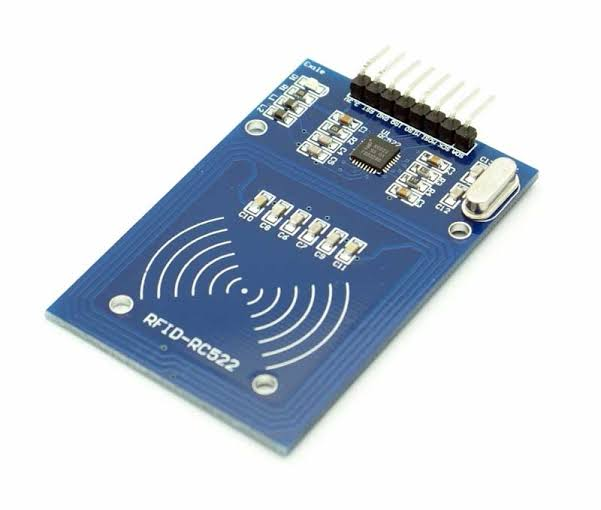

# RFID-RC522

## What it is

The **RC522** is a low-cost **SPI RFID reader** module. It detects nearby RFID tags/cards and reports an identifier (UID) over SPI to the micro:bit.

## How it works with EdgeBit

1. EdgeBit provides the micro:bit pins needed for SPI (and power/GND).
2. The RC522 is wired to those pins (see Wiring step).
3. MakeCode (with an RFID / RC522 extension) talks SPI to the module.
4. When a track tag enters range, the car firmware can react (effects are out of scope for this hardware guide).

## Facilitator notes

- Use **3V** power only (see pin map) — do not power from 5V.
- Keep the antenna face of the module clear of large metal plates that block reads.
- RST and IRQ are **not connected** in the working workshop wiring.
