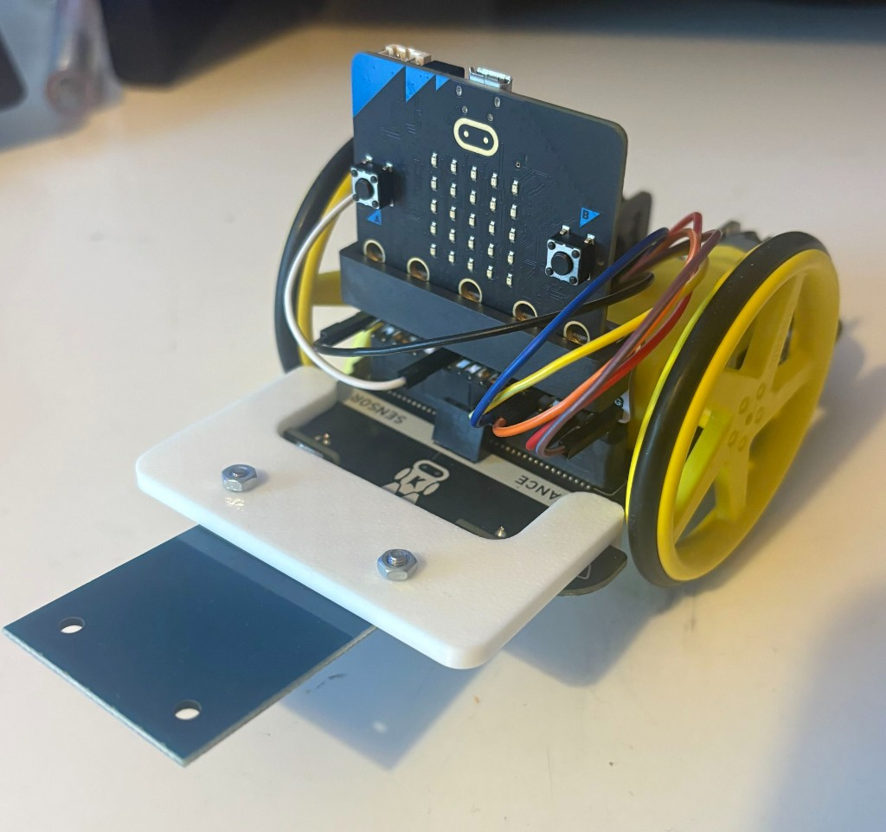

# Mounting on the car

## Goal

The RC522 should reliably see **track tags** as the car drives over or past them, without leads catching on wheels or the chassis.

## Facilitator tips

- Mount the module so the **antenna face** points toward where tags will be (usually downward toward the track, or outward if tags are on the side)
- Secure EdgeBit + leads so steering/drive motion does not pull connectors loose
- Keep jumper wires clear of wheels and moving parts
- After mounting, do a static read test (hold a tag near the scanner) before racing
- Keep spare tags and one known-good wired spare kit for mid-session swaps

## Remember

This guide stops at hardware. Tag effects (spin-out / slow) are configured in car software separately.
