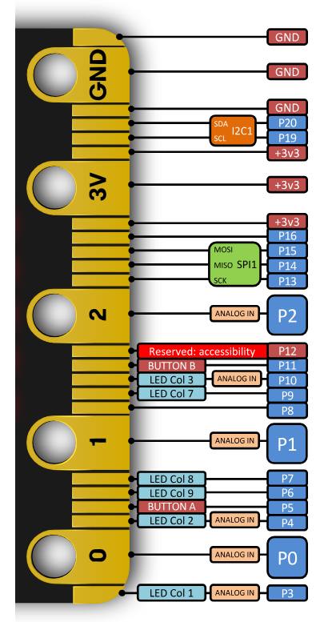

# Editing the RFID library (`custom.ts`)

This is **supplementary** facilitator content. Most kits only need the hardware wiring in the RFID & EdgeBit lab.

## When you need this

There are **many reasons** facilitators may need to edit the RFID library / `custom.ts` — not only the default SCK pin. For example:

- An older MakeCode RFID extension still assumes **SCK on P13**, but the kit is wired for **P9**
- A **broken or flaky pin on EdgeBit** (or the micro:bit) — remap SPI / CS to a healthy pin
- A pin that is **not driving enough voltage / signal** for reliable SPI — try another free pin and update `custom.ts` to match
- Wiring had to change mid-workshop (spare EdgeBit, different jumper layout, damaged lead)
- Tags still do not read even though the physical pin map looks correct

Whenever the **hardware pins change**, the TypeScript pin setup must match. The walkthrough below uses **P13 → P9** as the golden example of that kind of edit.

## Caution — check the micro:bit pinout

Remap pins **carefully**. Many edge-connector pins are shared with LEDs, buttons, I2C, accessibility, or other functions. Picking the wrong spare pin can break the display, buttons, or SPI entirely.

Always cross-check against the official micro:bit pinout before changing jumpers or `custom.ts`:



Prefer free GPIO that is not already used by the car / joystick stack, and keep power on **3V** / **GND** only for the RC522.

## Golden example

Default many RC522 MakeCode libraries:

```typescript
pins.spiPins(DigitalPin.P15, DigitalPin.P14, DigitalPin.P13) // MOSI, MISO, SCK
```

Workshop wiring needs SCK on **P9**. Leave it off **P0** — that pin is the speaker, and SPI traffic there ticks during reads:

```typescript
pins.spiPins(DigitalPin.P15, DigitalPin.P14, DigitalPin.P9) // MOSI, MISO, SCK
```

Use the same process for any other pin remap — find `pins.spiPins(...)` (and related CS / NSS pins such as **P16**), change them to match the working hardware, then redownload.
