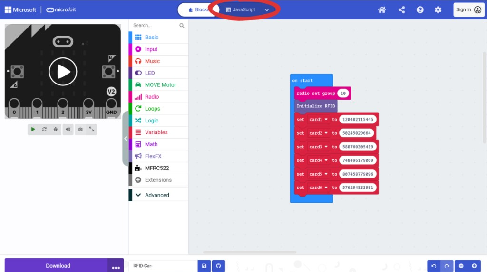
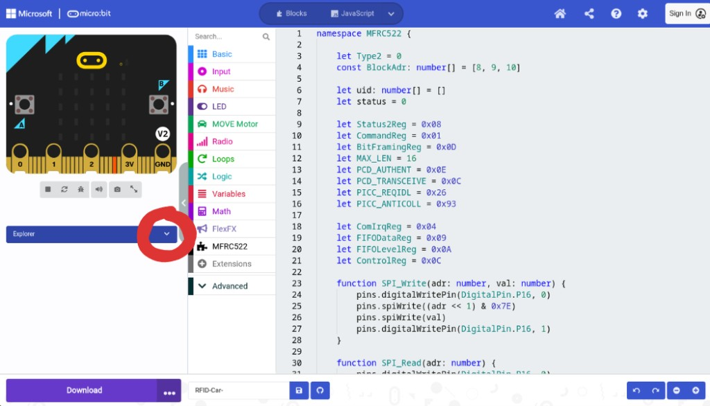
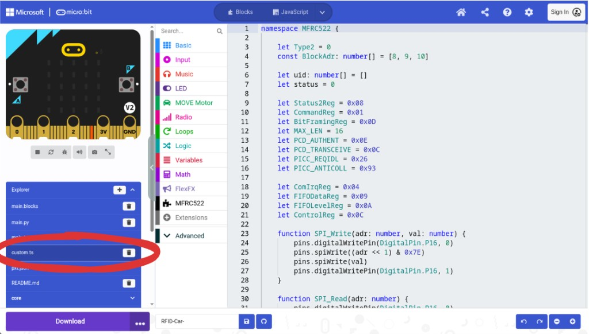

# Open `custom.ts` (MakeCode)

Use the facilitator reference project (or a kit copy of it):  
[https://makecode.microbit.org/_YbTgFfazUVa6](https://makecode.microbit.org/_YbTgFfazUVa6)

## Step 1 — Switch to JavaScript

Open the project in [MakeCode](https://makecode.microbit.org/). At the top, switch from **Blocks** to **JavaScript**.

## Step 2 — Open Explorer

Under the simulator, open **Explorer** (down arrow) so you can see the project / MFRC522 files.

## Step 3 — Open `custom.ts`

In Explorer, select **`custom.ts`**. This is the RFID library TypeScript for this project (MFRC522).

If `custom.ts` is missing, use Explorer **+** to add custom blocks / `custom.ts`, then put the RFID init / pin setup there.

Official MakeCode note: [https://makecode.microbit.org/blocks/custom](https://makecode.microbit.org/blocks/custom)
