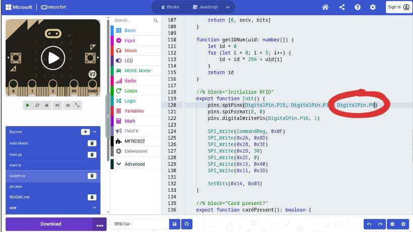

# Golden example: change SCK P13 → P9

In `custom.ts`, find the SPI pin setup inside **Initialize RFID** / `Init()`. Stock libraries often use **P13** for SCK. The previous workshop link used **P0**, which is the speaker pin and ticks on every read. This workshop needs **P9**.

Argument order is typically **MOSI, MISO, SCK**:

```typescript
// Before (common default — or DigitalPin.P0 on the previous workshop link)
pins.spiPins(DigitalPin.P15, DigitalPin.P14, DigitalPin.P13)

// After (workshop wiring)
pins.spiPins(DigitalPin.P15, DigitalPin.P14, DigitalPin.P9)
```

| Role | Before | After |
| --- | --- | --- |
| MOSI | P15 | P15 (unchanged) |
| MISO | P14 | P14 (unchanged) |
| SCK | **P13** (or **P0**) | **P9** |

## Step 4 — Edit the `spiPins` line

Change the third pin to **P9** (circled in the screenshot):



Also check nearby lines for any other hard-coded **P13** or **P0** used as SCK.

## Verify

1. **Download** the `.hex` to the car micro:bit
2. Hold a known-good tag near the RC522 antenna
3. Confirm a read / expected car reaction

If it still fails, re-check the hardware pin map (SDA→P16, SCK→P9, MOSI→P15, MISO→P14, VCC 3V, GND).
