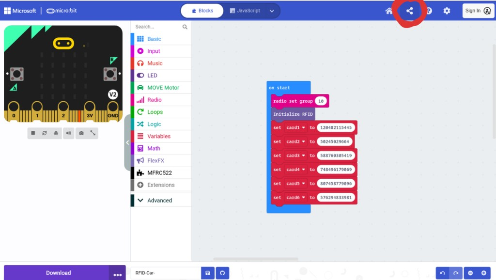
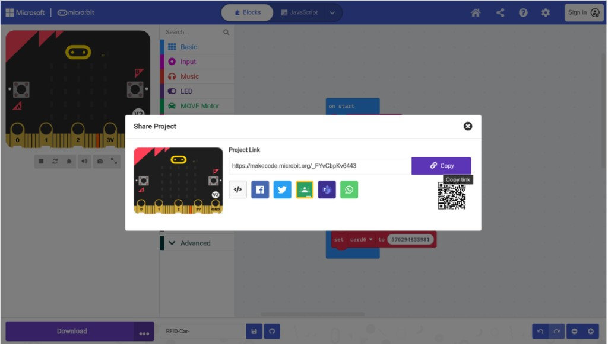

# Keeping firmware changes persistent

Editing `custom.ts` (or extension TypeScript) only updates **this project copy** in your browser.

Old **Share** links still point at the previous snapshot. Kits that open an outdated share URL will get the old library (for example SCK = P13) again.

## If you want the fix to stick for the workshop

1. Confirm your pin change works on a real car micro:bit
2. Publish a **new** Share link (steps below)
3. Replace the facilitator reference URL everywhere it is used (this course — Purpose / Firmware / this lab — and any kit runbook)
4. Tell facilitators to open the **new** link only

Until you regenerate and distribute the new share link, assume the old link is stale.

## Step 5 — Open Share

In MakeCode, click the **Share** icon in the top bar (circled):

## Step 6 — Copy the new project link

In the **Share Project** dialog, copy the new **Project Link** and use that URL going forward:

Do not keep handing out the previous share URL after a firmware / `custom.ts` change.
